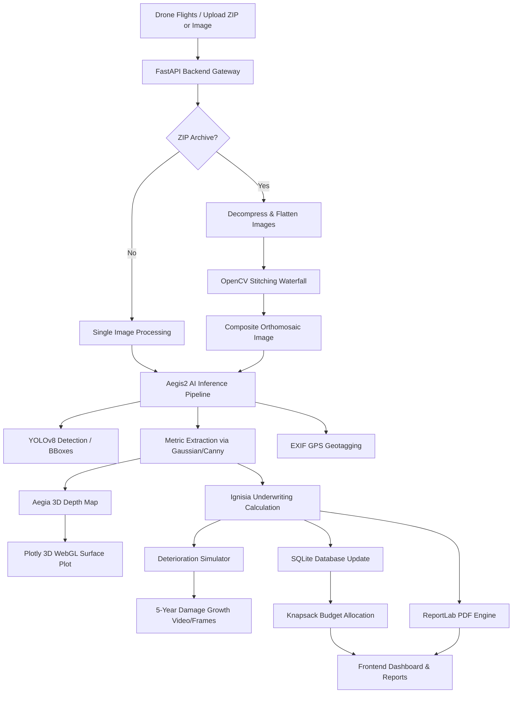

# AEGIS — Unified Infrastructure Intelligence Platform
## Technical Documentation & Architecture Reference Guide

> **AEGIS** — *Advanced Engineering & Geospatial Inspection System*  
> A production-grade structural inspection, predictive degradation, and insurance risk underwriter platform built for critical civil infrastructure.

---

## Table of Contents
1. [System Overview & Merged Abstraction](#1-system-overview--merged-abstraction)
2. [Architecture & Data Flow](#2-architecture--data-flow)
3. [Deep-Dive: Core Engines & Mathematical Modeling](#3-deep-dive-core-engines--mathematical-modeling)
   - [3.1 AI Crack Analysis Engine (Aegis2)](#31-ai-crack-analysis-engine-aegis2)
   - [3.2 Orthomosaic Image Stitching Waterfall](#32-orthomosaic-image-stitching-waterfall)
   - [3.3 Physics-Based Deterioration Simulation (Aegia 3D)](#33-physics-based-deterioration-simulation-aegia-3d)
   - [3.4 Underwriting & Insurance Risk Engine (Ignisia)](#34-underwriting--insurance-risk-engine-ignisia)
   - [3.5 Constrained Budget Optimizer](#35-constrained-budget-optimizer)
   - [3.6 PDF Report Generator](#36-pdf-report-generator)
4. [API Endpoints Reference](#4-api-endpoints-reference)
5. [Frontend Component Guide](#5-frontend-component-guide)
6. [Database Schema & Storage Layout](#6-database-schema--storage-layout)
7. [Civil Engineering Standards Compliance](#7-civil-engineering-standards-compliance)
8. [Installation & Deployment Guide](#8-installation--deployment-guide)

---

## 1. System Overview & Merged Abstraction

The **AEGIS** platform is a full-stack engineering solution that consolidates three previously isolated structural assessment and insurance domains into a single API-driven intelligence suite:

1. **Aegis2 (Computer Vision)**: Leverages deep learning (YOLOv8) and traditional image processing (Canny edge extraction) to detect and segment concrete fractures, extract raw dimensional metrics, and geotag inspection sites via EXIF GPS metadata.
2. **Aegia 3D (Simulation & Budgeting)**: Uses mathematical damage mechanics to model 5-year crack propagation, generate dynamic visual frames of deterioration, render 3D stress concentration depth topography (WebGL/Plotly), and allocate repair budgets across assets using Knapsack optimization.
3. **Ignisia (Insurance Risk Engine & PDF Reporting)**: Runs structural risk-rating logic to compute asset failure probabilities, reinsurance premium multipliers, and recommended intervention timelines, culminating in government-grade inspection report PDFs generated via ReportLab.

---

## 2. Architecture & Data Flow

AEGIS utilizes a modern decoupled client-server architecture:
- **Backend**: Built with **FastAPI** (Python), executing heavy workloads (YOLO inference, OpenCV stitching, ReportLab layout, SQLite queries).
- **Frontend**: A highly interactive single-page app (SPA) built using **React 19**, **Vite**, **Tailwind CSS**, **react-leaflet**, **Plotly.js**, and **Recharts**.

### High-Level System Data Flow



---

## 3. Deep-Dive: Core Engines & Mathematical Modeling

### 3.1 AI Crack Analysis Engine (Aegis2)
Files: [5_inference.py](file:///c:/Users/Athashree/Downloads/Aegis_3D-Sattyam/Aegis_3D-Sattyam/AEGIS%20-%20Final/backend/app/services/5_inference.py), [6_health_score.py](file:///c:/Users/Athashree/Downloads/Aegis_3D-Sattyam/Aegis_3D-Sattyam/AEGIS%20-%20Final/backend/app/services/6_health_score.py)

#### Bounding Box Detection
Runs a YOLOv8 detection model (`best.pt`) on the input image. For each detection, it crops the bounding box region.

#### Metric Extraction (Gaussian Blur + Canny Edge)
To accurately isolate the physical crack boundaries, AEGIS performs Canny edge detection within each bounding box:
1. Converts the crop to grayscale: $I(x,y)$
2. Applies a Gaussian filter for smoothing:
   $$G_\sigma(x, y) = \frac{1}{2\pi\sigma^2} e^{-\frac{x^2 + y^2}{2\sigma^2}}$$
3. Extracts edges using a dual-threshold hysteresis:
   $$\text{Edges} = \text{Canny}(I_{\text{smoothed}}, \text{threshold}_1=50, \text{threshold}_2=150)$$
4. Calculates the physical contour bounding width and counts active pixels to estimate physical crack area percentage ($\text{Area}\%$) relative to the entire frame.

#### ACI 224R-01 Health Scoring
Crack type is classified based on the bounding box aspect ratio and relative area into `hairline`, `longitudinal`, `transverse`, `structural`, or `alligator`.
The engine applies standard acceptance crack width thresholds ($\text{Limit}_{\text{mm}}$) per environment:
- **Buildings**: $0.30 \text{ mm}$
- **Bridges**: $0.15 \text{ mm}$
- **Roads**: $0.41 \text{ mm}$

The health score ($H_{\text{base}}$) is calculated using a weighted composite formula:
$$H_{\text{base}} = (S_{\text{width}} \times 0.50) + (S_{\text{area}} \times 0.30) + (S_{\text{type}} \times 0.20)$$

*   **Width Score ($S_{\text{width}}$)**: 100 if $\text{max\_width\_mm} \le \text{Limit}_{\text{mm}}$. If exceeded, drops 10 points for every $0.1\text{ mm}$ of excess.
*   **Area Score ($S_{\text{area}}$)**: Penalizes based on the percentage of structural crack area: $S_{\text{area}} = \max(0, 100 - \text{TotalArea}\% \times 10)$.
*   **Type Score ($S_{\text{type}}$)**: Penalizes based on classification severity weights: $\text{hairline} (0.1)$, $\text{longitudinal} (0.3)$, $\text{transverse} (0.4)$, $\text{structural} (0.7)$, $\text{alligator} (0.9)$. $S_{\text{type}} = 100 \times (1 - W_{\text{max\_type}})$.

#### Structural Severity Index (SSI)
The SSI represents the overall active hazard of the asset, modifying the raw health penalty by accounting for environmental and physical variables:
$$\text{SSI} = (\text{Penalty}_{\text{crack}} \times A_{\text{mult}}) + (D_{\text{base}} \times (1 + E_{\text{boost}})) + Z_{\text{penalties}}$$

*   $\text{Penalty}_{\text{crack}} = 100 - H_{\text{base}}$
*   $D_{\text{base}} = \text{age} \times 0.15$ (Base aging degradation of concrete matrix)
*   $A_{\text{mult}}$: Age multiplier (1.0 for $\le 5$ years, 1.1 for $>5$, 1.3 for $>20$, 1.6 for $>50$)
*   $E_{\text{boost}}$: Environmental boost factor ($\sum \text{factors}$; seismic $= +0.3$, marine $= +0.2$, heavy traffic $= +0.15$)
*   $Z_{\text{penalties}}$: Flat penalties for hazard zones (seismic $= +5.0$, marine $= +3.0$, heavy traffic $= +2.0$)

The final health score returned is: $H_{\text{final}} = \max(0.0, 100.0 - \text{SSI})$.

---

### 3.2 Orthomosaic Image Stitching Waterfall
File: [stitcher.py](file:///c:/Users/Athashree/Downloads/Aegis_3D-Sattyam/Aegis_3D-Sattyam/AEGIS%20-%20Final/backend/scripts/stitcher.py)

For drone photogrammetry flights, images are uploaded as a batch or inside a ZIP archive. The engine downscales images larger than 1024px (to avoid Out-Of-Memory exceptions) and runs a **4-strategy waterfall model** to maximize the probability of a successful stitch:

| Strategy | OpenCV Stitcher Mode | Confidence Threshold | Description |
|:---|:---|:---|:---|
| **1** | `Stitcher_PANORAMA` | `0.3` | Standard spherical panoramic stitching |
| **2** | `Stitcher_SCANS` | `0.3` | Flat nadir stitching (suitable for top-down drone inspections) |
| **3** | `Stitcher_PANORAMA` | `0.1` | Panorama stitching with relaxed homography constraints |
| **4** | `Stitcher_SCANS` | `0.1` | Scans stitching with relaxed homography constraints |

If a strategy succeeds, it returns the composite image immediately. If all fail, an error is returned suggesting a minimum of 40% image overlap.

---

### 3.3 Physics-Based Deterioration Simulation (Aegia 3D)
Files: [simulation_engine.py](file:///c:/Users/Athashree/Downloads/Aegis_3D-Sattyam/Aegis_3D-Sattyam/AEGIS%20-%20Final/backend/app/services/simulation_engine.py), [aegis_model.py](file:///c:/Users/Athashree/Downloads/Aegis_3D-Sattyam/Aegis_3D-Sattyam/AEGIS%20-%20Final/backend/app/services/aegis_model.py)

To project structural degradation over 5 years (calculated in $0.5$-year steps, generating 11 frames), AEGIS models damage growth over time ($t$ in years):

#### Physical Growth Models
*   **Length Growth**:
    $$L(t) = L_0 \times (1 + 0.12t + 0.03t^2)$$
*   **Width Growth**:
    $$W(t) = W_0 \times (1 + 0.10t + 0.02t^2)$$
*   **Depth Growth**:
    $$D(t) = D_0 \times (1 + 0.15t + 0.04t^2)$$

#### Fractal Branching Model
If $t > 1.0$, the simulator extracts the contours of the original crack mask and picks random points. It projects crack branches using fractal growth vectors:
$$\Delta x = \cos(\theta) \times L_{\text{branch}}, \quad \Delta y = \sin(\theta) \times L_{\text{branch}}$$
Where $\theta \sim U(0, 2\pi)$ and $L_{\text{branch}} = U(10t, 30t)$ pixels.

#### Spalling and Surface Discoloration
The engine simulates spalling zones (concrete breaking away around cracks) using a distance transform. Pixels near the crack edges ($d < 1 + 2.5t$) are blended with a high-frequency Gaussian noise grid to mimic surface pitting and rough textures:
$$I_{\text{spall}} = \alpha I_{\text{base}} + (1-\alpha) I_{\text{noisy}}, \quad \text{with } \alpha = 0.4$$

#### Topographical WebGL Depth Maps
Plotly renders 3D depth maps on the client by analyzing pixel intensities. Darker crack centers indicate deeper fractures. The backend downsamples this matrix to a $60 \times 80$ grid and generates a coordinate matrix $Z$ containing relative values mapped from $[0, -1]$.

---

### 3.4 Underwriting & Insurance Risk Engine (Ignisia)
File: [risk_engine.py](file:///c:/Users/Athashree/Downloads/Aegis_3D-Sattyam/Aegis_3D-Sattyam/AEGIS%20-%20Final/backend/app/services/risk_engine.py)

Ignisia calculates a comprehensive risk score (0-100) using structural and operational parameters.

#### 1. Point Allocation (Subtotal out of 100 points)
*   **Severity Score ($S_{\text{sev}}$)**: Maps 1-5 to $\{1: 5, 2: 10, 3: 17, 4: 24, 5: 30\}$ points.
*   **Crack Depth ($S_{\text{depth}}$)**:
    - $<2 \text{ mm}$ (surface hairline): $2 \text{ pts}$
    - $2-5 \text{ mm}$ (minor): $6 \text{ pts}$
    - $5-10 \text{ mm}$ (moderate): $11 \text{ pts}$
    - $10-20 \text{ mm}$ (severe): $16 \text{ pts}$
    - $>20 \text{ mm}$ (critical): $20 \text{ pts}$
*   **Crack Growth ($S_{\text{growth}}$)**: No data ($5 \text{ pts}$), $<10\%$ stable ($2 \text{ pts}$), $10-25\%$ slow ($6 \text{ pts}$), $25-50\%$ moderate ($10 \text{ pts}$), $>50\%$ rapid ($15 \text{ pts}$).
*   **Defect Count ($S_{\text{count}}$)**: $1 \text{ crack} (2 \text{ pts})$, $2-3 (4 \text{ pts})$, $4-6 (6 \text{ pts})$, $7-10 (8 \text{ pts})$, $>10 (10 \text{ pts})$.
*   **Structure Age ($S_{\text{age}}$)**: $<10 \text{ yrs} (1 \text{ pt})$, $10-25 (3 \text{ pts})$, $25-40 (5 \text{ pts})$, $40-60 (7.5 \text{ pts})$, $>60 (10 \text{ pts})$.
*   **Traffic Level ($S_{\text{traffic}}$)**: Low ($2 \text{ pts}$), Medium ($4 \text{ pts}$), High ($7 \text{ pts}$), Overloaded ($10 \text{ pts}$).
*   **Geometry Bonus ($S_{\text{bonus}}$)**: Adds up to 5 points if crack area exceeds $100 \text{ cm}^2$ ($+2.5 \text{ pts}$) or length exceeds $500 \text{ mm}$ ($+2.5 \text{ pts}$).

#### 2. Risk Multipliers
The subtotal is multiplied by three factors:
$$\text{RawScore} = \text{Subtotal} \times M_{\text{infra}} \times M_{\text{temporal}} \times M_{\text{env}}$$

*   **Infrastructure Multiplier ($M_{\text{infra}}$)**: culvert ($1.00$), retaining wall ($1.05$), tunnel ($1.15$), flyover ($1.20$), bridge ($1.25$), dam ($1.30$).
*   **Temporal Multiplier ($M_{\text{temporal}}$)**: $1.20$ if growth exceeds $50\%$; $1.10$ if growth exceeds $25\%$; $1.00$ otherwise.
*   **Environmental Multiplier ($M_{\text{env}}$)**: $1.0 + \sum \text{conditions}$ (seismic zone $= +0.15$, maritime corrosion $= +0.10$).

The final underwriting risk score is: $S_{\text{risk}} = \min(\text{RawScore}, 100.0)$.

#### 3. Actuarial Calculations
*   **Failure Probability ($P_{\text{failure}}$)**: Modeled using a logistic sigmoid curve:
    $$P_{\text{failure}} = \frac{100}{1 + e^{-0.10 \times (S_{\text{risk}} - 50)}}$$
*   **Insurance Claim Probability ($P_{\text{claim}}$)**:
    $$P_{\text{claim}} = \min(P_{\text{failure}} \times 0.78, 99.9\%)$$
*   **Premium Multiplier ($P_{\text{prem}}$)**:
    - $S_{\text{risk}} < 30 \implies 1.00\times$
    - $30 \le S_{\text{risk}} < 50 \implies 1.0 + \frac{S_{\text{risk}} - 30}{20} \times 0.5$
    - $50 \le S_{\text{risk}} < 70 \implies 1.5 + \frac{S_{\text{risk}} - 50}{20} \times 0.5$
    - $70 \le S_{\text{risk}} < 85 \implies 2.0 + \frac{S_{\text{risk}} - 70}{15} \times 0.8$
    - $S_{\text{risk}} \ge 85 \implies 2.8 + \frac{S_{\text{risk}} - 85}{15} \times 1.2$ (Capped at $4.00\times$)

#### 4. Action Decision Grid
*   **Low** ($S_{\text{risk}} < 30$): Routine Monitoring (Re-inspect in 365 days)
*   **Moderate** ($30 \le S_{\text{risk}} < 55$): Enhanced Monitoring (Re-inspect in 90 days)
*   **High** ($55 \le S_{\text{risk}} < 75$): Repair Required (Remediate in 30 days)
*   **Emergency** ($75 \le S_{\text{risk}} < 85$): Emergency Inspection (Audit in 7 days, limit loads)
*   **Critical** ($S_{\text{risk}} \ge 85$): Immediate Closure (Stop traffic, close structural segments)

---

### 3.5 Constrained Budget Optimizer
File: [budget_db.py](file:///c:/Users/Athashree/Downloads/Aegis_3D-Sattyam/Aegis_3D-Sattyam/AEGIS%20-%20Final/backend/app/services/budget_db.py)

Given a global maintenance budget ($B$), AEGIS selects which structures to repair using a knapsack algorithm.

#### Physical Repair Impact Model
A repair intervention reduces crack physical bounds:
*   $\text{Length}_{\text{post}} = \text{Length}_{\text{pre}} \times 0.30$
*   $\text{Width}_{\text{post}} = \text{Width}_{\text{pre}} \times 0.35$
*   $\text{Depth}_{\text{post}} = \text{Depth}_{\text{pre}} \times 0.40$

A post-repair health score and risk score are recalculating based on these parameters to find the **Risk Reduction** ($\Delta \text{Risk} = \text{Risk}_{\text{pre}} - \text{Risk}_{\text{post}}$).

#### Optimization Formula
AEGIS calculates the **Repair Efficiency** ($E_i$) for each structure $i$:
$$E_i = \frac{\Delta \text{Risk}_i}{\text{RepairCost}_i}$$

The optimizer solves the bounded Knapsack problem by sorting assets by $E_i$ descending and applying a greedy selection logic:
$$\text{Maximize } \sum_{i \in A} \Delta \text{Risk}_i \cdot x_i \quad \text{subject to} \quad \sum_{i \in A} \text{RepairCost}_i \cdot x_i \le B, \quad x_i \in \{0, 1\}$$

---

### 3.6 PDF Report Generator
File: [pdf_generator.py](file:///c:/Users/Athashree/Downloads/Aegis_3D-Sattyam/Aegis_3D-Sattyam/AEGIS%20-%20Final/backend/app/services/pdf_generator.py)

The reporting module uses **ReportLab** flowables to assemble a multi-page PDF document. Key architecture features include:
- **Two-Pass Canvas Rendering**: Overrides `pdfcanvas.Canvas` (`_HeaderFooterCanvas`) to scan the page list first and append headers/footers dynamically showing exact `"Page X of Y"` page numbers, skipping the cover.
- **Embedded Charts**: Draws SVG-like vectors directly into PDF byte streams using ReportLab's `Drawing` and `Rect` canvas commands to generate semi-circular risk gauges and vertical bar charts.

---

## 4. API Endpoints Reference

All endpoints are hosted by default on `http://localhost:8000`.

### Crack Analysis
*   `POST /api/analysis/analyze`
    *   **Description**: Run YOLOv8 detection and analysis on a single upload.
    *   **Form Data**: `file` (UploadFile), `structure_type` (str), `age_years` (int), `is_seismic` (bool), `is_near_sea` (bool), `has_heavy_traffic` (bool).
    *   **Response**: `AnalysisResponse` Pydantic model containing base64 images, health/severity indexes, and detailed crack lists.
*   `POST /api/analysis/analyze/batch`
    *   **Description**: Multi-file inspection upload returning individual asset cards.
*   `POST /analyze/stitch`
    *   **Description**: Takes a list of images, stitches them using the waterfall mode, and runs AI inference on the resulting orthomosaic.
*   `POST /analyze/stitch-zip`
    *   **Description**: Processes a ZIP file containing drone photogrammetry images, extracts them, stitches them, and performs a single unified analysis on the orthomosaic.

### FEA Simulation
*   `POST /api/simulation/upload`
    *   **Description**: Processes a temporary upload file to generate a baseline mask and depth coordinates.
*   `GET /api/simulation/simulate-upload/{session_id}`
    *   **Description**: Runs the 5-year propagation simulation on an uploaded asset and returns frame URLs.
*   `GET /api/simulation/simulate/{structure_id}`
    *   **Description**: Pulls a structure from the DB and simulates its deterioration.

### Risk and Budget
*   `POST /api/risk/score`
    *   **Description**: Accepts a structured defect inventory payload and returns risk statistics.
*   `GET /api/risk/rankings`
    *   **Description**: Returns all assets sorted by Priority score.
*   `POST /api/budget/optimize`
    *   **Description**: Accepts a numeric `budget` and returns optimized repair selections, cost usage, and total regional risk reduction.

---

## 5. Frontend Component Guide

The React SPA utilizes atomic UI components to render data received from FastAPI:

*   **[Layout.jsx](file:///c:/Users/Athashree/Downloads/Aegis_3D-Sattyam/Aegis_3D-Sattyam/AEGIS%20-%20Final/frontend/src/components/layout/Layout.jsx)**: Implements the primary dashboard frame, loading bars, and sidebar routing.
*   **[AssetHealthDashboard.jsx](file:///c:/Users/Athashree/Downloads/Aegis_3D-Sattyam/Aegis_3D-Sattyam/AEGIS%20-%20Final/frontend/src/components/AssetHealthDashboard.jsx)**: Renders KPIs (Mean Health, Critical Assets Count, Reinsurance Premium averages) and Recharts line charts for regional health trends.
*   **[OnSiteAnalysis.tsx](file:///c:/Users/Athashree/Downloads/Aegis_3D-Sattyam/Aegis_3D-Sattyam/AEGIS%20-%20Final/frontend/src/components/OnSiteAnalysis.tsx)**: Handles interactive image dropzones, camera streams, and structured form fields (age, seismic checkboxes) for real-time inference.
*   **[GpsMap.tsx](file:///c:/Users/Athashree/Downloads/Aegis_3D-Sattyam/Aegis_3D-Sattyam/AEGIS%20-%20Final/frontend/src/components/GpsMap.tsx)**: Integrates Leaflet to display interactive map pins using the latitude and longitude coordinates extracted from EXIF headers.
*   **[ThreeDView.jsx](file:///c:/Users/Athashree/Downloads/Aegis_3D-Sattyam/Aegis_3D-Sattyam/AEGIS%20-%20Final/frontend/src/components/ThreeDView.jsx)**: Renders a WebGL canvas showing the depth map projection using Plotly's surface charts.
*   **[Simulator.jsx](file:///c:/Users/Athashree/Downloads/Aegis_3D-Sattyam/Aegis_3D-Sattyam/AEGIS%20-%20Final/frontend/src/components/Simulator.jsx)**: Features a time-slider linked to the simulation frame indexes, overlaying deterioration masks on top of structural images.
*   **[BudgetOptimizer.jsx](file:///c:/Users/Athashree/Downloads/Aegis_3D-Sattyam/Aegis_3D-Sattyam/AEGIS%20-%20Final/frontend/src/components/BudgetOptimizer.jsx)**: Provides sliders to dynamically adjust repair funding and renders tables displaying before-and-after health metrics for prioritized assets.

---

## 6. Database Schema & Storage Layout

### SQLite Schema (`structures` table)
Maintained in `backend/app/services/Data/budget.db`:

```sql
CREATE TABLE structures (
    id INTEGER PRIMARY KEY AUTOINCREMENT,
    structure_name TEXT,       -- Code identifier (e.g., INSP-001)
    structure_type TEXT,       -- bridge, dam, building, road
    location TEXT,             -- GPS Coordinates or name
    crack_length REAL,         -- Baseline crack length (px)
    crack_width REAL,          -- Baseline crack width (px)
    crack_depth REAL,          -- Baseline crack depth (px)
    severity_score INTEGER,    -- Categorical severity (1-5)
    health_score REAL,         -- Health index (0-100)
    risk_score REAL,           -- Insurance risk (0-100)
    repair_cost REAL,          -- Estimated repair cost (in Lakhs/Crores)
    replacement_cost REAL,     -- Estimated total rebuild cost
    traffic_load TEXT,         -- Low, Medium, High, Overloaded
    age INTEGER,               -- Age of the structure in years
    priority_score REAL        -- Combined sort score
);
```

### Disk Storage Layout

```
backend/data/
├── uploads/               # Raw uploads & temporary stitching workspaces
├── images/                # Extracted images for PDF processing
├── masks/                 # Binary segment overlays (PNG)
├── depth/                 # Extracted depth maps
├── simulation_frames/     # Rendered time-step growth images (JPEG)
└── Dummydataset/          # Pre-loaded inspectable assets
```

---

## 7. Civil Engineering Standards Compliance

AEGIS aligns its algorithms with structural engineering code parameters:

*   **ACI 224R-01 (American Concrete Institute)**: Specifies maximum tolerable crack widths under varying environmental conditions. Used directly in the health scoring engine's environment limit mapping.
*   **IS:456-2000 (Indian Standard code of practice for plain and reinforced concrete)**: Used for classifying crack severity patterns and selecting appropriate repair methods.
*   **IS 1893 (Indian Standard Criteria for Earthquake Resistant Design of Structures)**: Adjusts the Structural Severity Index (SSI) and recommended repair materials (e.g., carbon-fiber wraps) when structures are marked as being in active seismic zones.
*   **ASTM C 881 (Standard Specification for Epoxy-Resin-Base Bonding Systems for Concrete)**: Cited in PDF recommendations when specifying epoxy injection repairs for cracks exceeding $0.75\text{ mm}$ in width.

---

## 8. Installation & Deployment Guide

### Prerequisites
*   Python 3.10+
*   Node.js 18+
*   Model weights (`best.pt`) placed in `backend/models/crack_detection/weights/`

### Backend Initialization
```bash
cd "backend"
python -m venv venv
venv\Scripts\activate
pip install -r requirements.txt
uvicorn app.main:app --host 0.0.0.0 --port 8000 --reload
```

### Frontend Initialization
```bash
cd "frontend"
npm install
npm run dev -- --port 5173 --host 127.0.0.1
```
The application will proxy requests to the backend API via the Vite development server configurations.
